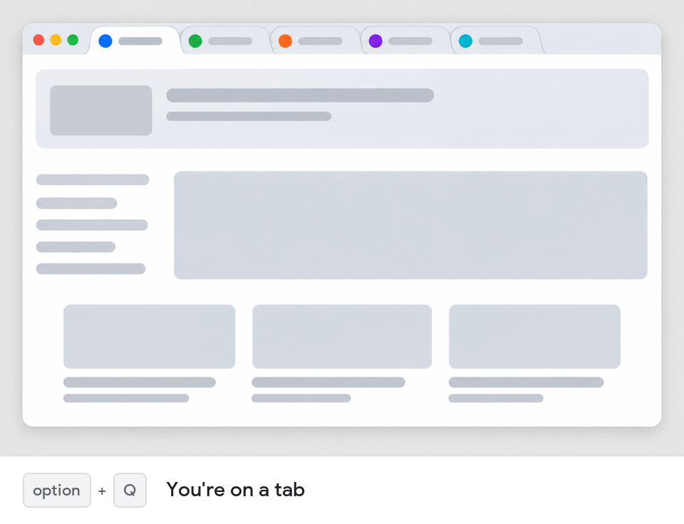

# Tab Switcher

English | [日本語](README.ja.md)

A Chrome extension that lets you switch tabs the same way you switch windows with Alt+Tab. It shows your tabs in most-recently-used order in the center of the screen, so you can jump back to a previous tab using only the keyboard.



## Features

Tab Switcher lists the tabs in every window of the same Chrome profile. The only shortcut you need is `Option+Q` (`Alt+Q` on Windows).

- Press `Option+Q` to show the list in most-recently-used order, with the previous tab selected.
- Keep holding Option and press Q again to move to the next tab. After the last tab, the selection wraps around to the first one.
- Release Option to switch to the selected tab.

A quick single press of `Option+Q` takes you straight back to the previous tab. Press it again to return, which makes it easy to go back and forth between two tabs.

Click the Tab Switcher icon in the toolbar to check the shortcut that is currently assigned and how to use it. If the shortcut was left unassigned because another extension already uses it, you can see that here too.

You can also click a row to switch. Press Esc or click outside the list to close it without switching. If the list stays open after you release Option, press Enter to switch to the selected tab.

## Languages

Tab Switcher supports English and Japanese. The shortcut description and the text in the list follow Chrome's display language. For any other language, English is used.

## Installation

Tab Switcher is not yet available on the Chrome Web Store, so load the folder directly.

1. Open `chrome://extensions` in Chrome and turn on Developer mode in the top-right corner.
2. Click Load unpacked and select the folder of this repository.
3. Open `chrome://extensions/shortcuts` and check that the Tab Switcher shortcut is set to `⌥Q`. If another extension already uses it, the field is left empty, so set it manually.

To use Tab Switcher in another Chrome profile, load it in each profile the same way.

## Changing the shortcut

You can change the key at any time at `chrome://extensions/shortcuts`. Extension shortcuts can use A–Z, 0–9, Comma, Period, Space, the arrow keys, and a few others. The Tab key cannot be assigned.

Keep Option (Alt on Windows) in the new shortcut. Tab Switcher switches tabs when you release Option, so a shortcut without Option will not switch.

While `Option+Q` is assigned, you cannot type the special character it produces (`œ`) in Chrome. If another app or tool uses `Option+Q` system-wide on your Mac, that app takes priority and the list does not appear.

## Limitations

Because Tab Switcher runs as a Chrome extension, it has the following limitations.

- It works only while Chrome is in front. You cannot call it from other apps.
- The list shows only the tabs of the profile where the extension is installed.
- On the New Tab page, pages that start with `chrome://`, the Chrome Web Store, and sites where a management policy blocks extensions, the list cannot be shown on top of the page. In that case, a small window with the list opens in the center of the current window. It works the same way, but takes a moment to open.

## Privacy

Tab titles and URLs are used only inside your browser to show the list. The record of recently used tabs is kept in `chrome.storage.session` and is cleared when you close the browser. Nothing is sent to any external server. For details, see the [privacy policy](PRIVACY.md).

## Project structure

No build step is needed. The extension is written in plain JavaScript.

| File | Role |
|---|---|
| `manifest.json` | Permissions and shortcut definition |
| `_locales/` | English and Japanese text |
| `background.js` | Records recently used tabs, receives the shortcut, and switches tabs |
| `content.js` | Shows the list on top of the current page |
| `popup.html` / `popup.css` / `popup.js` | Toolbar popup that shows the current shortcut and how to use it |
| `switcher.html` / `switcher.css` / `switcher.js` | The tab list (shared by the page overlay and the small window) |
| `lib/order.js` | Sorts tabs in most-recently-used order |
| `lib/page.js` | Decides from the URL whether the list can be shown on the page |
| `icons/` | Extension icons (source: `assets/icon.svg`) |
| `scripts/package.sh` | Creates the ZIP for the Chrome Web Store in `dist/` |
| `scripts/store-screenshot.sh` | Resizes screenshots to the Chrome Web Store size (1280×800) |
| `test/` | Unit tests for `lib/` and the language files |
| `docs/design.md` | Design document (Japanese) |
| `docs/store-listing.md` | Draft of the Chrome Web Store listing (Japanese) |
| `store/` | Screenshots and text for the Chrome Web Store |

## Tests

The functions in `lib/` can be tested with Node.js 20 or later. There are no dependencies to install.

```bash
node --test
```

Keyboard behavior and the display are checked manually in Chrome. The checklist is in the Tests section of the design document (`docs/design.md`).
