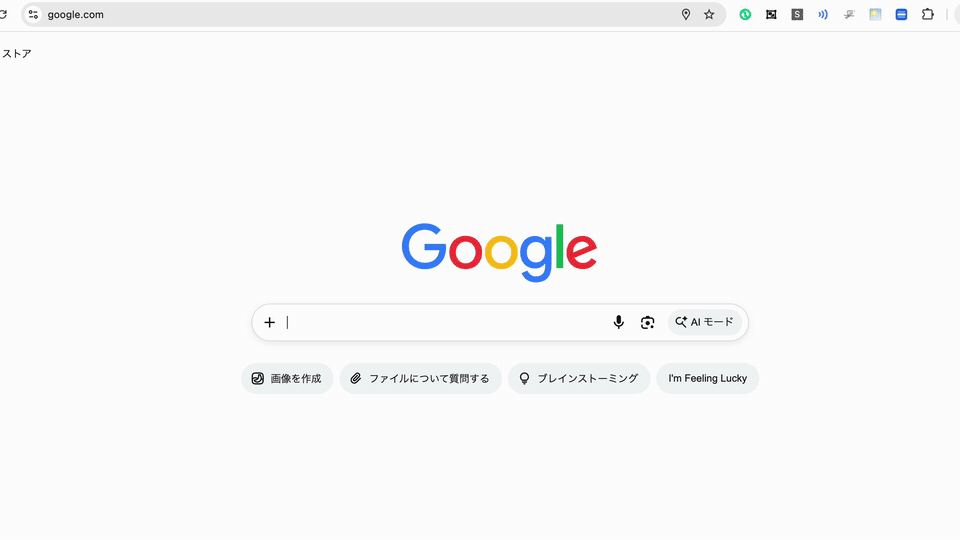

# Tab Switcher

macOS の Alt+Tab 系のウィンドウ切り替えツールと同じ感覚で、Chrome のタブを切り替える拡張機能です。最近使った順に並んだ一覧を画面の中央に出し、キーボードだけで前のタブに戻れます。



## できること

同じ Chrome プロファイルで開いている、すべてのウィンドウのタブを一覧にします。操作は `Option+Q` キーだけです。

- `Option+Q` キーを押すと、最近使った順に一覧が出て、直前のタブが選ばれた状態になります。
- Option キーを押したまま Q キーを押すたびに、次のタブへ移ります。最後まで進むと先頭に戻ります。
- Option キーを離すと、選んでいるタブに切り替わります。

`Option+Q` キーを 1 回だけすばやく押すと、直前のタブに戻ります。もう一度押せば元のタブに戻るので、2 つのタブを行き来するときに便利ですよ。

ツールバーの Tab Switcher のアイコンを押すと、いま割り当てられているショートカットと使い方を確認できます。ショートカットがほかの拡張機能と重なって未設定になっている場合も、ここでわかります。

行をクリックしても切り替わります。Esc キーか一覧の外側のクリックで、何もせずに閉じます。Option キーを離しても一覧が閉じないときは、Enter キーを押すと選んでいるタブに切り替わります。

## 対応している言語

英語と日本語に対応しています。ショートカットの説明や一覧の文言は、Chrome の表示言語に合わせて切り替わります。どちらでもない言語のときは英語で表示します。

## インストール

Chrome ウェブストアには公開していないので、フォルダを直接読み込みます。

1. Chrome で `chrome://extensions` を開き、右上の「デベロッパー モード」をオンにします。
2. 「パッケージ化されていない拡張機能を読み込む」をクリックし、このリポジトリのフォルダを選びます。
3. `chrome://extensions/shortcuts` を開き、Tab Switcher のショートカットが `⌥Q` になっているかを確かめます。ほかの拡張機能と重なっている場合は空欄になるので、手動で設定してください。

別の Chrome プロファイルでも使う場合は、プロファイルごとに同じ手順で読み込みます。

## ショートカットの変更

キーは `chrome://extensions/shortcuts` でいつでも変えられます。拡張機能のショートカットに使えるのは A〜Z、0〜9、カンマ、ピリオド、Space、矢印キーなどで、Tab キーは割り当てられません。

`Option+Q` キーを割り当てている間は、Chrome の中でこのキーで特殊文字（`œ`）を入力できなくなります。また、ほかのアプリやツールが Mac 全体で `Option+Q` キーを使っていると、そちらが優先されて一覧が出ません。

## 制約

Chrome 拡張機能として動くので、次の制約があります。

- Chrome が前面にあるときだけ使えます。ほかのアプリからは呼び出せません。
- 一覧に出るのは、拡張機能を入れたプロファイルのタブだけです。
- 新しいタブ、`chrome://` で始まるページ、Chrome ウェブストア、管理ポリシーで拡張機能の操作が禁止されたサイトでは、ページに一覧を重ねられません。その場合は、ウィンドウの中央に一覧だけの小さなウィンドウを開きます。操作は同じですが、開くまでに一瞬かかります。

## プライバシー

タブのタイトルと URL は、一覧を表示するためにブラウザの中でだけ使います。使った順の記録は `chrome.storage.session` に置き、ブラウザを閉じると消えます。外部のサーバーには一切送信しません。詳しくは [プライバシー ポリシー](PRIVACY.md) をご覧ください。

## ファイル構成

ビルドは不要で、素の JavaScript だけで書いています。

| ファイル | 役割 |
|---|---|
| `manifest.json` | 権限とショートカットの定義 |
| `_locales/` | 英語と日本語の文言 |
| `background.js` | タブを使った順の記録、ショートカットの受け取り、タブの切り替え |
| `content.js` | 表示中のページに一覧を重ねる |
| `popup.html` / `popup.css` / `popup.js` | ツールバーのアイコンを押したときの説明（ショートカットと使い方） |
| `switcher.html` / `switcher.css` / `switcher.js` | 一覧の画面（ページへの重ね表示と専用ウィンドウで共用） |
| `lib/order.js` | タブを最近使った順に並べる |
| `lib/page.js` | ページに一覧を差し込めるかを URL から判定する |
| `icons/` | 拡張機能アイコン（元データは `assets/icon.svg`） |
| `scripts/package.sh` | Chrome ウェブストアにアップロードする ZIP を `dist/` に作る |
| `scripts/store-screenshot.sh` | スクリーンショットをストアのサイズ（1280×800）にそろえる |
| `test/` | `lib/` の単体テスト |
| `docs/design.md` | 設計書 |
| `docs/store-listing.md` | Chrome ウェブストアの掲載情報の下書き |
| `store/` | Chrome ウェブストアに載せるスクリーンショット（1280×800） |

## テスト

`lib/` の関数は Node.js 20 以上で単体テストできます。依存パッケージはないので、インストールは不要です。

```bash
node --test
```

キー操作や表示は Chrome で実際に確かめます。確認項目は設計書（`docs/design.md`）の「テスト」にまとめています。
